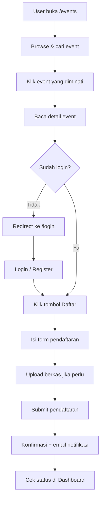
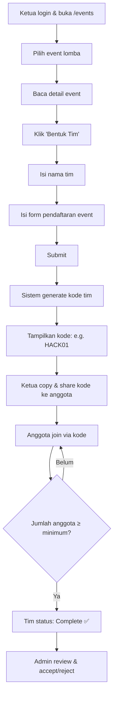
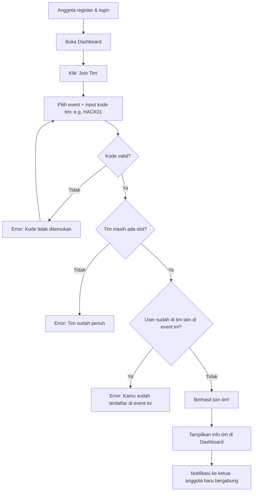
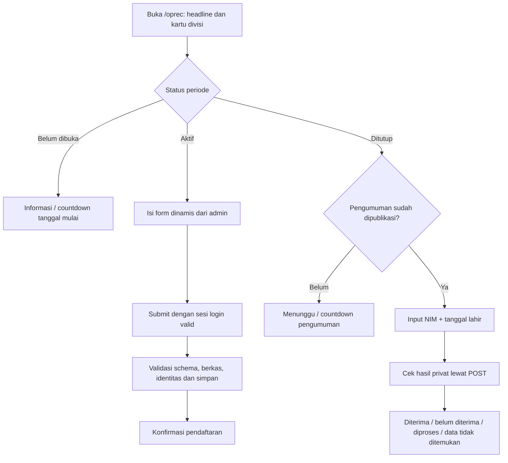
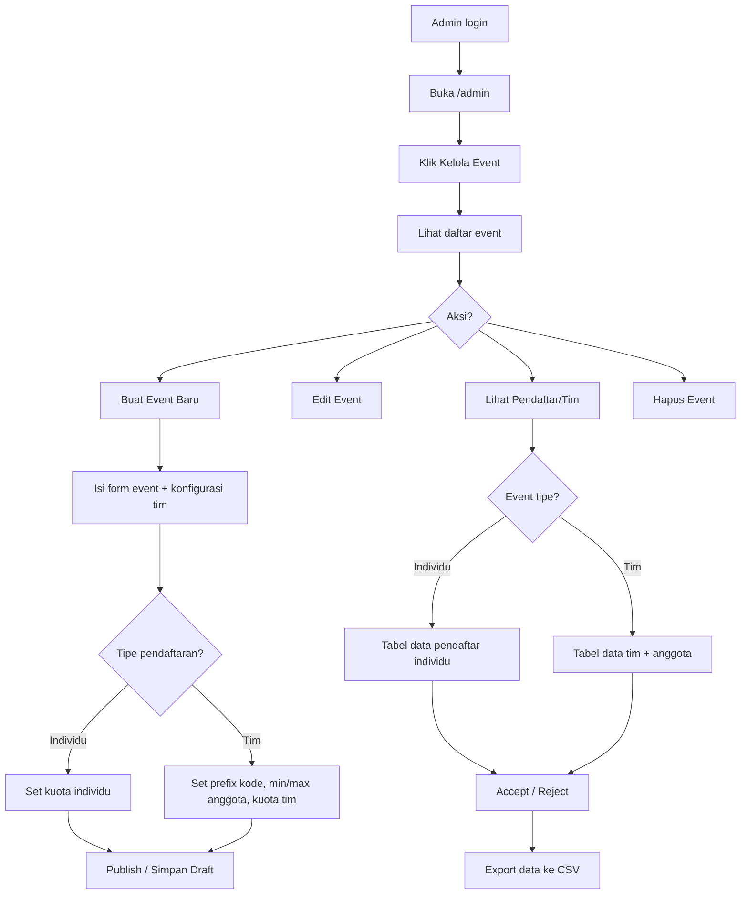

# 📄 PRD — SIMANIKA (Sistem Informasi HIMANIKA)

> **Product Requirements Document**
> Versi: 1.1
> Tanggal: 13 September 2026
> Status: Draft — Stack teknis telah diselaraskan

---

## 1. Ringkasan Produk

**SIMANIKA** (Sistem Informasi HIMANIKA) adalah platform web resmi untuk organisasi **HIMANIKA** (Himpunan Mahasiswa Informatika) yang berfungsi sebagai:

1. **Portal informasi organisasi** — Menampilkan profil, visi-misi, struktur organisasi, dan kegiatan HIMANIKA.
2. **Platform manajemen event** — Mengelola dan mempublikasikan event, lomba, dan kegiatan organisasi.
3. **Sistem pendaftaran** — Menyediakan form pendaftaran untuk event, lomba, dan open recruitment (OPREC) anggota baru.
4. **Portal merchandise** — Menjembatani kerja sama dengan pihak eksternal (sponsor, media partner, dll).

### Referensi Konsep
Website [ifestunpad.com](https://ifestunpad.com) digunakan sebagai referensi **konsep dan struktur halaman**, bukan style/design.

---

## 2. Tujuan & Sasaran

### 2.1 Tujuan Bisnis
| # | Tujuan | Metrik Keberhasilan |
|---|--------|---------------------|
| 1 | Digitalisasi informasi organisasi HIMANIKA | Seluruh info organisasi tersedia online |
| 2 | Mempermudah pendaftaran event & oprec | ≥ 80% pendaftaran dilakukan via web |
| 3 | Meningkatkan visibilitas organisasi | Peningkatan traffic web & engagement |
| 4 | Mempermudah pengelolaan data peserta | Admin dapat mengelola data dalam 1 dashboard |
| 5 | Menarik merchandise/sponsor | Tersedia portal khusus merchandise |

### 2.2 Target Pengguna
- **Mahasiswa** — Calon anggota, peserta event/lomba
- **Anggota HIMANIKA** — Pengurus organisasi yang mengelola konten
- **Pihak Eksternal** — Sponsor, media partner, institusi yang ingin bekerja sama

---

## 3. User Roles & Permissions

### 3.1 Role: User (Publik / Mahasiswa)

| Akses | Deskripsi |
|-------|-----------|
| Melihat Landing Page | Baca semua informasi di halaman Home |
| Melihat Event & Lomba | Browse daftar event yang tersedia |
| Mendaftar Event/Lomba | Mengisi form pendaftaran event |
| Mendaftar OPREC | Mengisi form open recruitment anggota |
| Melihat merchandise | Melihat daftar sponsor & partner |
| Login / Register | Membuat akun untuk mendaftar event |
| Melihat Status Pendaftaran | Cek status pendaftaran (diterima/pending/ditolak) |

### 3.2 Role: Admin (Pengurus HIMANIKA)

| Akses | Deskripsi |
|-------|-----------|
| Semua akses User | Ditambah fitur pengelolaan |
| Kelola Event | CRUD (Create, Read, Update, Delete) event & lomba |
| Kelola OPREC | Buka/tutup periode OPREC, kelola form, kelola pendaftar |
| Kelola merchandise | CRUD data sponsor & media partner |
| Kelola Pendaftar | Lihat, filter, accept/reject pendaftar event & oprec |
| Dashboard Analytics | Melihat statistik pendaftar, event, dll |
| Kelola Konten Home | Update info organisasi (about, struktur, dll) |

---

## 4. Arsitektur Halaman

### 4.1 Sitemap

```
SIMANIKA
├── 🏠 Public Pages (Tanpa Login)
│   ├── / (Home / Landing Page)
│   ├── /events (Daftar Event & Lomba)
│   ├── /events/[slug] (Detail Event)
│   ├── /oprec (Open Recruitment)
│   ├── /merchandise (merchandise & Sponsor)
│   ├── /login (Login Page)
│   └── /register (Register Page)
│
├── 👤 User Pages (Perlu Login)
│   ├── /dashboard (User Dashboard)
│   ├── /events/[slug]/register (Form Pendaftaran Event)
│   ├── /oprec/daftar (Form Pendaftaran OPREC)
│   └── /profile (Profil User)
│
└── 🔒 Admin Pages (Perlu Login Admin)
    ├── /admin (Admin Dashboard)
    ├── /admin/users (Kelola User / Manajemen Pengguna)
    ├── /admin/events (Kelola Event)
    ├── /admin/events/create (Buat Event Baru)
    ├── /admin/events/[id]/edit (Edit Event)
    ├── /admin/events/[id]/pendaftar (Data Pendaftar Event)
    ├── /admin/oprec (Kelola OPREC)
    ├── /admin/oprec/pendaftar (Data Pendaftar OPREC)
    ├── /admin/merchandise (Kelola merchandise)
    └── /admin/settings (Pengaturan Website)
```

---

## 5. Detail Halaman & Fitur

### 5.1 🏠 Home / Landing Page (`/`)

Landing page utama yang menampilkan seluruh informasi organisasi HIMANIKA secara lengkap dari atas ke bawah.

#### Section Breakdown:

| # | Section | Deskripsi | Konten |
|---|---------|-----------|--------|
| 1 | **Navbar** | Navigasi utama, sticky di atas | Logo SIMANIKA, Menu (Home, Event, OPREC, merchandise), Tombol Login |
| 2 | **Hero** | Banner utama yang eye-catching | Tagline HIMANIKA, CTA button ("Lihat Event", "Gabung Sekarang"), background visual/animasi |
| 3 | **About** | Penjelasan tentang HIMANIKA | Apa itu HIMANIKA, sejarah singkat, deskripsi organisasi |
| 4 | **Visi & Misi** | Visi dan misi organisasi | Visi organisasi, daftar misi |
| 5 | **Struktur Organisasi** | Bagan pengurus | Foto + nama + jabatan pengurus inti (Ketua, Wakil, Sekretaris, Bendahara, Kadiv, dll) |
| 6 | **Divisi** | Penjelasan divisi-divisi | Card/grid setiap divisi beserta deskripsi tugas & fungsinya |
| 7 | **Program Kerja** | Highlight program kerja unggulan | Daftar proker utama dengan icon/ilustrasi |
| 8 | **Statistik** | Angka-angka pencapaian | Counter animasi: jumlah anggota, event terselenggara, peserta, dll |
| 9 | **Upcoming Events** | Preview event terbaru | 3-4 card event terdekat dengan countdown timer |
| 10 | **Gallery** | Dokumentasi kegiatan | Grid foto kegiatan HIMANIKA |
| 11 | **Testimonial** | Testimoni anggota/alumni | Slider quote dari anggota/alumni |
| 12 | **CTA Section** | Ajakan bergabung | "Tertarik Bergabung?" dengan tombol ke OPREC & Event |
| 13 | **Footer** | Informasi kontak & sosmed | Alamat, email, link sosial media, quick links, copyright |

---

### 5.2 📅 Event Page (`/events`)

Halaman yang menampilkan semua event, lomba, dan kegiatan yang diselenggarakan HIMANIKA.

#### Fitur:
- **Filter & Search** — Filter berdasarkan kategori (Lomba, Seminar, Workshop, dll), status (Upcoming, Ongoing, Selesai)
- **Event Cards** — Grid/list card dengan:
  - Poster/thumbnail event
  - Judul event
  - Tanggal & waktu
  - Lokasi (online/offline)
  - Tipe pendaftaran badge: 🏆 Tim / 👤 Individu
  - Status badge (Segera, Buka, Tutup, Selesai)
  - Jumlah slot tersisa (jika ada kuota)
  - Tombol "Daftar" / "Lihat Detail"

#### Detail Event Page (`/events/[slug]`):
- Banner/poster event
- Deskripsi lengkap event
- Timeline/jadwal event
- Syarat & ketentuan
- Hadiah/benefit (jika lomba)
- **Info tim** (jika event bertipe tim): min/max anggota, jumlah tim terdaftar
- Tombol pendaftaran: **"Bentuk Tim"** atau **"Daftar Sekarang"** (tergantung tipe event)
- Countdown timer (jika belum dimulai)
- Status pendaftaran user (jika sudah login)

#### Form Pendaftaran Event (`/events/[slug]/register`):
- Form dinamis (field disesuaikan admin per event)
- Upload file (jika diperlukan, misal: KTM, proposal, dll)
- Konfirmasi pendaftaran
- Notifikasi email setelah daftar

---

### 5.2.1 🏆 Sistem Tim untuk Event Lomba

Event bertipe **lomba** menggunakan sistem pendaftaran berbasis **tim** dengan kode unik.

#### Konsep Utama:

> [!IMPORTANT]
> Setiap event lomba memiliki **kode prefix** yang di-custom oleh admin (misal: `HACK` untuk Hackathon, `CTF` untuk CTF, `UXUI` untuk UI/UX). Kode tim otomatis di-generate sebagai `PREFIX` + `NOMOR URUT 2 DIGIT`, contoh:
> - `HACK01`, `HACK02`, `HACK03`, ...
> - `CTF01`, `CTF02`, `CTF03`, ...
> - `UXUI01`, `UXUI02`, `UXUI03`, ...

#### Flow Pendaftaran Tim:

| Step | Aksi | Detail |
|------|------|--------|
| 1 | **Ketua Tim** login | Ketua membuka halaman event lomba |
| 2 | **Ketua klik "Bentuk Tim"** | Ketua memilih event & mengisi data tim (nama tim, dll) |
| 3 | **Kode Tim di-generate** | Sistem otomatis generate kode unik (e.g., `HACK01`) |
| 4 | **Ketua bagikan kode** | Ketua share kode ke anggota tim (via WA, dll) |
| 5 | **Anggota register & login** | Setiap anggota buat akun & login ke SIMANIKA |
| 6 | **Anggota klik "Join Tim"** | Di dashboard, anggota memilih event lalu memasukkan kode |
| 7 | **Anggota bergabung** | Sistem validasi kode → anggota masuk ke tim |
| 8 | **Tim lengkap** | Ketika jumlah anggota memenuhi minimum, tim dianggap siap |

#### Aturan Tim:

| Aturan | Detail |
|--------|--------|
| **Min/Max anggota** | Diatur per event oleh admin (misal: min 3, max 5) |
| **1 user = 1 tim per event** | User tidak bisa join lebih dari 1 tim di event yang sama |
| **Ketua = pembuat tim** | User yang membuat tim otomatis jadi ketua |
| **Ketua bisa kick** | Ketua bisa mengeluarkan anggota sebelum deadline |
| **Anggota bisa leave** | Anggota bisa keluar dari tim sebelum deadline |
| **Tim tanpa ketua** | Jika ketua keluar, anggota pertama yang join jadi ketua baru |
| **Kode tidak bisa diubah** | Kode tim bersifat permanen setelah di-generate |
| **Kode case-insensitive** | `HACK01` = `hack01` saat input |

#### Tampilan Kode Tim:

Setelah ketua membuat tim, muncul halaman/modal:

```
┌─────────────────────────────────────────┐
│   ✅ Tim Berhasil Dibuat!               │
│                                         │
│   Nama Tim: Sigma Coders                │
│   Event: Hackathon HIMANIKA 2026        │
│                                         │
│   ┌─────────────────────────┐           │
│   │     HACK01              │  [📋 Copy]│
│   └─────────────────────────┘           │
│                                         │
│   Bagikan kode ini ke anggota timmu!    │
│   Anggota: 1/5 (min. 3)                │
│                                         │
│   [Lihat Tim Saya]  [Kembali ke Event]  │
└─────────────────────────────────────────┘
```

---

### 5.3 📋 OPREC Page (`/oprec`)

> Revisi alur pengguna, 21 September 2026. Kontrak lengkap: [OPREC](frontend/docs/oprec.md).

Urutan halaman: **headline → kartu ringkas divisi → pendaftaran/pengumuman → FAQ**.
Headline, penjelasan, divisi, poster, jadwal, field form, dan FAQ dapat diisi admin.
Poster berada di area pendaftaran. Tidak ada section timeline/benefit terpisah.

- Belum ada periode: informasi belum dibuka.
- Admin membuka periode tetapi tanggal mulai belum tiba: countdown hari/jam/menit/detik.
- Jadwal aktif: form inline dengan field dinamis dari admin; submit tetap memakai autentikasi Sanctum.
- Ditutup: area yang sama menjadi tempat pengumuman, menunggu publikasi admin.
- Saat pengumuman dipublikasikan: masukkan NIM + tanggal lahir untuk melihat diterima,
  belum diterima, masih diproses, atau data tidak ditemukan. Lookup hasil tidak perlu login.
- FAQ menjadi section terakhir sebelum footer.

Form mendukung text, email, tel, url (Link), number, date, textarea, select, radio, checkbox, dan
file. NIM serta tanggal lahir wajib tersedia dalam schema untuk pencocokan hasil;
kolom lain, opsi, kewajiban, dan batas berkas ditentukan admin. Hasil seleksi tidak
tersedia pada payload publik halaman. Endpoint lookup memakai POST, no-store,
validasi pasangan identitas, publikasi terjadwal, serta rate limit backend.

---

### 5.4 🤝 merchandise Page (`/merchandise`)

Halaman untuk menarik dan menampilkan kerja sama dengan pihak eksternal.

#### Section Breakdown:

| # | Section | Deskripsi |
|---|---------|-----------|
| 1 | **Header** | Judul "merchandise" dengan tagline |
| 2 | **Statistik Organisasi** | Jumlah anggota, event, peserta, jangkauan — untuk meyakinkan partner |
| 3 | **Benefit merchandise** | Apa yang didapat partner (exposure, branding, dll) |
| 4 | **Paket Sponsorship** | Tabel/card tier sponsor (Platinum, Gold, Silver, dll) |
| 5 | **Sponsor Saat Ini** | Logo grid sponsor & media partner yang sudah bekerja sama |
| 6 | **Form Kolaborasi** | Form pengajuan kerja sama: Nama, Instansi, Email, Paket yang diminati, Pesan |

---

### 5.5 🔑 Auth Pages

#### Login Page (`/login`):
- **Layout split-screen**:
  - **Kiri**: Branding HIMANIKA — tagline, ilustrasi/visual
  - **Kanan**: Form login (Email, Password, "Lupa Password?", tombol Login)
- Login sosial tidak termasuk MVP; dapat ditambahkan pasca-MVP melalui integrasi backend yang disetujui
- **Link ke Register** untuk user baru

#### Register Page (`/register`):
- Form: Nama Lengkap, Email, NIM, Jurusan, Password, Konfirmasi Password
- Checkbox persetujuan Terms of Service
- Link ke Login untuk yang sudah punya akun

---

### 5.6 👤 User Dashboard (`/dashboard`)

Dashboard pribadi user setelah login.

#### Fitur:
| Fitur | Deskripsi |
|-------|-----------|
| Ringkasan | Overview event yang diikuti, status pendaftaran, tim aktif |
| **Tim Saya** | Daftar tim yang dibuat/diikuti, kode tim, status anggota |
| Event Saya | Daftar event yang didaftar + status (pending/accepted/rejected) |
| OPREC Saya | Status pendaftaran OPREC (jika ada) |
| Profil | Edit data profil (nama, email, foto, dll) |
| Notifikasi | Pemberitahuan perubahan status, event baru, dll |

#### Section "Tim Saya" (Detail):

Di dashboard user, ada section khusus untuk mengelola tim.

**Tampilan awal (belum punya tim di event manapun):**
```
┌──────────────────────────────────────────────┐
│  🏆 Tim Saya                                │
│                                              │
│  Kamu belum tergabung dalam tim apapun.      │
│                                              │
│  ┌──────────────┐  ┌──────────────┐          │
│  │ 🆕 Bentuk Tim│  │ 🔗 Join Tim  │          │
│  └──────────────┘  └──────────────┘          │
└──────────────────────────────────────────────┘
```

**Tombol "Bentuk Tim"** → User memilih event lomba yang tersedia → mengisi nama tim → kode tim di-generate.

**Tombol "Join Tim"** → Modal muncul dengan pilihan event dan input kode tim:
```
┌─────────────────────────────────────┐
│  🔗 Join Tim                        │
│                                     │
│  Pilih Event & Masukkan Kode Tim:   │
│  ┌─────────────────────┐            │
│  │  HACK__              │            │
│  └─────────────────────┘            │
│                                     │
│  [Gabung]  [Batal]                  │
└─────────────────────────────────────┘
```

**Tampilan setelah punya tim:**
```
┌──────────────────────────────────────────────┐
│  🏆 Tim Saya                                │
│                                              │
│  ┌────────────────────────────────────────┐  │
│  │  Hackathon HIMANIKA 2026              │  │
│  │  Tim: Sigma Coders   Kode: HACK01     │  │
│  │  Role: Ketua Tim                      │  │
│  │  Anggota: 3/5 ✅ (min. terpenuhi)     │  │
│  │  Status: Terdaftar                    │  │
│  │  [Kelola Tim]                         │  │
│  └────────────────────────────────────────┘  │
│                                              │
│  ┌──────────────┐  ┌──────────────┐          │
│  │ 🆕 Bentuk Tim│  │ 🔗 Join Tim  │          │
│  └──────────────┘  └──────────────┘          │
└──────────────────────────────────────────────┘
```

**Halaman "Kelola Tim" (Ketua saja):**
- Lihat daftar anggota (nama, NIM, role)
- Copy kode tim
- Kick anggota (sebelum deadline)
- Lihat status pendaftaran tim

---

### 5.7 🔒 Admin Dashboard (`/admin`)

Panel administrasi untuk pengurus HIMANIKA.

#### Fitur Utama:

| Modul | Fitur |
|-------|-------|
| **Dashboard** | Statistik ringkasan: total user, total event, total pendaftar, total tim, grafik tren |
| **Kelola User** | Manajemen direktori pengguna, pantau aktivitas pendaftaran program (event & oprec), tetapkan hak akses role (Admin/User) dengan safeguard admin terakhir, edit biodata, dan hapus akun |
| **Kelola Event** | CRUD event, atur form pendaftaran, buka/tutup pendaftaran, set kuota, **konfigurasi sistem tim** |
| **Data Pendaftar Event** | Tabel data peserta/tim per event, filter, search, export CSV/Excel, accept/reject |
| **Data Tim** | Lihat semua tim per event, anggota per tim, kode tim, status tim |
| **Kelola OPREC** | Buka/tutup periode OPREC, kelola divisi, atur form |
| **Data Pendaftar OPREC** | Tabel data calon anggota, filter per divisi, accept/reject, export |
| **Kelola merchandise** | CRUD data sponsor/partner, upload logo, atur tier |
| **Kelola Konten** | Update teks About, Visi-Misi, Struktur (CMS sederhana) |
| **Pengaturan** | Kelola akun admin, pengaturan umum website |

#### Konfigurasi Sistem Tim (Saat Buat/Edit Event Lomba):

Ketika admin membuat event dengan kategori **lomba**, muncul section tambahan:

| Field | Deskripsi | Contoh |
|-------|-----------|--------|
| **Tipe Pendaftaran** | Dropdown: Individu / Tim | Tim |
| **Kode Prefix** | Input teks, max 6 karakter, huruf kapital | `HACK` |
| **Min. Anggota Tim** | Jumlah minimum anggota per tim | 3 |
| **Max. Anggota Tim** | Jumlah maksimum anggota per tim | 5 |
| **Kuota Tim** | Jumlah tim maksimum (null = unlimited) | 30 |

**Preview kode** ditampilkan real-time saat admin mengetik prefix:
```
Kode Prefix: [HACK    ]     Preview: HACK01, HACK02, HACK03, ...
Kode Prefix: [CTF     ]     Preview: CTF01, CTF02, CTF03, ...
Kode Prefix: [UXUI    ]     Preview: UXUI01, UXUI02, UXUI03, ...
```

#### Tampilan Data Tim di Admin:

```
┌──────────────────────────────────────────────────────────┐
│  📊 Data Tim — Hackathon HIMANIKA 2026                  │
│                                                          │
│  Total Tim: 15    Tim Lengkap: 12    Tim Belum Lengkap: 3│
│                                                          │
│  🔍 [Search...]  [Filter: Semua ▼]  [Export CSV]        │
│                                                          │
│  ┌────┬──────────┬────────┬────────┬──────────┬────────┐ │
│  │Kode│ Nama Tim │ Ketua  │Anggota │ Status   │ Aksi   │ │
│  ├────┼──────────┼────────┼────────┼──────────┼────────┤ │
│  │HACK01│Sigma   │Andi   │ 4/5    │✅ Lengkap│[Detail]│ │
│  │HACK02│Phoenix │Budi   │ 3/5    │✅ Lengkap│[Detail]│ │
│  │HACK03│Nova    │Citra  │ 2/5    │⚠️ Kurang │[Detail]│ │
│  └────┴──────────┴────────┴────────┴──────────┴────────┘ │
└──────────────────────────────────────────────────────────┘
```

---

## 6. Non-Functional Requirements

### 6.1 Desain & UX

| Aspek | Requirement |
|-------|-------------|
| **Style** | Modern, clean, professional — dark theme dengan aksen gradient sebagai opsi utama |
| **Responsif** | Fully responsive (Mobile, Tablet, Desktop) |
| **Aksesibilitas** | Contrast ratio memadai, keyboard navigable, semantic HTML |
| **Animasi** | Smooth scroll, fade-in on scroll, hover effects, micro-interactions |
| **Loading** | Skeleton loading state, optimized images (WebP/AVIF) |
| **Dark/Light Mode** | Opsional — toggle dark/light theme |

### 6.2 Performa

| Metrik | Target |
|--------|--------|
| First Contentful Paint (FCP) | < 1.5s |
| Largest Contentful Paint (LCP) | < 2.5s |
| Cumulative Layout Shift (CLS) | < 0.1 |
| Time to Interactive (TTI) | < 3.5s |
| Lighthouse Performance | ≥ 85 |
| Lighthouse Accessibility | ≥ 90 |
| Lighthouse SEO | ≥ 90 |

### 6.3 Keamanan

| Aspek | Detail |
|-------|--------|
| Autentikasi | Laravel Sanctum SPA authentication berbasis session/cookie HttpOnly |
| Otorisasi | Role-based access control (User vs Admin) |
| Data | HTTPS, PostgreSQL constraints, authorization policy, dan least-privilege access |
| Input Validation | Client-side + server-side validation |
| File Upload | Whitelist ekstensi, max size limit |
| Proteksi API | CSRF, rate limiting, CORS origin terbatas, dan audit log aksi admin penting |
| Privasi | Persetujuan pemrosesan data, kontrol akses berkas, serta kebijakan retensi/penghapusan |

### 6.4 SEO

| Aspek | Detail |
|-------|--------|
| Meta Tags | Title, description, OG tags per halaman |
| Semantic HTML | Proper heading hierarchy, landmark elements |
| Sitemap | Auto-generated sitemap.xml |
| Robots | robots.txt yang terkonfigurasi |
| SSR/SSG | Server-side rendering untuk public pages |

---

## 7. Tech Stack (Rekomendasi)

| Layer | Teknologi | Alasan |
|-------|-----------|--------|
| **Framework** | Next.js 15+ (App Router) | SSR/SSG, Server Components, routing, dan performance |
| **Language** | JavaScript (JSX/ES Modules) | Konsisten dengan struktur file dan backlog implementasi |
| **Styling** | Tailwind CSS + shadcn/ui | Rapid development, consistent design system |
| **Backend** | Laravel 11 (PHP 8.2+) | REST API, validasi, queue, mail, dan business logic |
| **Auth** | Laravel Sanctum | SPA authentication berbasis cookie HttpOnly dan CSRF protection |
| **Database** | PostgreSQL 15+ | Relasional, ACID, constraint kuat, dan transaksi untuk sistem tim |
| **Storage** | Laravel Storage (local/S3-compatible) | Penyimpanan upload terkontrol dan dapat dipindahkan antar-provider |
| **Hosting** | Vercel | Gratis, CI/CD, optimized untuk Next.js |
| **Email** | Laravel Mail + SMTP | Notifikasi pendaftaran dan perubahan status melalui queue |
| **Analytics** | Google Analytics 4 | Traffic monitoring |

---

## 8. Data Model

### 8.1 Entitas Relasional (PostgreSQL)

Model data diimplementasikan sebagai tabel PostgreSQL melalui migration dan Eloquent. Contoh JSON di bawah adalah **bentuk data logis/API**, bukan struktur collection Firestore.

Tabel domain utama: `users`, `events`, `event_form_fields`, `event_prizes`, `event_requirements`, `teams`, `team_members`, `event_registrations`, `file_uploads`, `oprecs`, `oprec_divisions`, `oprec_registrations`, `merchandises`, `merchandise_inquiries`, `site_contents`, `struktur_organisasi`, `divisi`, `program_kerja`, `galleries`, dan `testimonials` (**20 tabel domain**; tabel infrastruktur Laravel dihitung terpisah).

#### `users`
```json
{
  "id": "integer (primary key)",
  "email": "string",
  "namaLengkap": "string",
  "nim": "string",
  "jurusan": "string",
  "angkatan": "number",
  "role": "user | admin",
  "fotoProfil": "string (URL)",
  "createdAt": "timestamp",
  "updatedAt": "timestamp"
}
```

#### `events`
```json
{
  "id": "string (auto-generated)",
  "judul": "string",
  "slug": "string (URL-friendly)",
  "deskripsi": "string (Rich text / Markdown)",
  "kategori": "lomba | seminar | workshop | lainnya",
  "poster": "string (URL gambar)",
  "tanggalMulai": "timestamp",
  "tanggalSelesai": "timestamp",
  "deadlinePendaftaran": "timestamp",
  "lokasi": "string",
  "tipe": "online | offline | hybrid",
  "kuota": "number | null (null = unlimited)",
  "status": "draft | published | closed | selesai",
  "tipePendaftaran": "individu | tim",
  "teamSettings": {
    "kodePrefix": "string (e.g., HACK, CTF, UXUI — max 6 chars, uppercase)",
    "minAnggota": "number (min anggota per tim, e.g., 3)",
    "maxAnggota": "number (max anggota per tim, e.g., 5)",
    "kuotaTim": "number | null (max jumlah tim, null = unlimited)",
    "lastTeamNumber": "number (counter auto-increment, starts at 0)"
  },
  "formFields": [
    { "label": "string", "type": "string", "required": "boolean" }
  ],
  "hadiah": ["string (jika lomba)"],
  "syarat": ["string"],
  "createdBy": "string (Admin UID)",
  "createdAt": "timestamp",
  "updatedAt": "timestamp"
}
```

> [!NOTE]
> Pengaturan tim hanya digunakan jika `tipePendaftaran` = `"tim"`. `lastTeamNumber` diperbarui secara atomic menggunakan transaksi PostgreSQL dan row-level lock.

#### `teams` ⭐ NEW
```json
{
  "id": "string (auto-generated)",
  "eventId": "string (ref ke event)",
  "kodeUnik": "string (e.g., HACK01, CTF03 — unique bersama eventId)",
  "namaTim": "string",
  "ketuaId": "integer (userId ketua tim; sumber kebenaran tunggal untuk ketua)",
  "anggota": [
    {
      "userId": "string",
      "namaLengkap": "string",
      "nim": "string",
      "joinedAt": "timestamp"
    }
  ],
  "jumlahAnggota": "number (denormalized count untuk query)",
  "completionStatus": "incomplete | complete",
  "reviewStatus": "pending | accepted | rejected",
  "formData": "object (data form tim jika ada)",
  "fileUploads": ["string (URLs file)"],
  "catatan": "string (catatan dari admin)",
  "createdAt": "timestamp",
  "updatedAt": "timestamp"
}
```

> [!IMPORTANT]
> **Logika status tim:**
> - `completionStatus` hanya menunjukkan kelengkapan roster: `incomplete` atau `complete`.
> - `reviewStatus` hanya menunjukkan keputusan admin: `pending`, `accepted`, atau `rejected`.
> - Roster terkunci setelah tim diterima atau deadline pendaftaran terlewati.
>
> **Logika generate kode:**
> 1. Saat ketua membuat tim, sistem baca `lastTeamNumber` dari event
> 2. Increment +1 secara atomic dalam transaksi PostgreSQL (`lockForUpdate`)
> 3. Format: `kodePrefix` + nomor dengan **lebar minimum** 2 digit
> 4. Contoh: `HACK01`, `HACK99`, lalu `HACK100`
> 5. Saat join, client wajib mengirim `eventId` dan `kodeUnik`; constraint unik adalah pasangan `(event_id, kode_unik)`

#### `eventRegistrations` (Updated — untuk event individu)
```json
{
  "id": "integer",
  "eventId": "integer",
  "userId": "integer",
  "formData": "object (data sesuai formFields event)",
  "fileUploads": ["string (URLs file)"],
  "status": "pending | accepted | rejected",
  "catatan": "string (catatan dari admin)",
  "createdAt": "timestamp",
  "updatedAt": "timestamp"
}
```

> `event_registrations` hanya untuk pendaftaran individu. Pendaftaran tim memakai `teams` dan `team_members`; form, upload, kelengkapan roster, dan keputusan review tim tidak diduplikasi ke `event_registrations`.

#### `oprec`
```json
{
  "id": "string",
  "periode": "string (e.g., 2026/2027)",
  "status": "open | closed",
  "tanggalBuka": "timestamp",
  "tanggalTutup": "timestamp",
  "deskripsi": "string",
  "headline": "string",
  "poster": "string URL | null",
  "schemaVersion": "string",
  "formFields": [{ "name": "string", "type": "string", "label": "string", "required": true }],
  "pengumuman": { "published": false, "tanggal": "timestamp | null", "pesan": "string" },
  "faq": [{ "pertanyaan": "string", "jawaban": "string" }],
  "divisiTersedia": [
    { "nama": "string", "deskripsi": "string", "kuota": "number" }
  ],
  "createdAt": "timestamp",
  "updatedAt": "timestamp"
}
```

#### `oprecRegistrations`
```json
{
  "id": "string",
  "oprecId": "string",
  "userId": "string",
  "nim": "string (unique bersama oprecId)",
  "tanggalLahir": "date (privat, untuk pencocokan hasil)",
  "formData": "object (sesuai schema form admin)",
  "divisiPilihan1": "string",
  "divisiPilihan2": "string | null",
  "motivasi": "string",
  "pengalamanOrganisasi": "string",
  "fileUploads": {
    "cv": "string (URL)",
    "foto": "string (URL)"
  },
  "status": "pending | accepted | rejected",
  "catatan": "string",
  "createdAt": "timestamp",
  "updatedAt": "timestamp"
}
```

#### `merchandises`
```json
{
  "id": "string",
  "namaInstansi": "string",
  "logo": "string (URL)",
  "tier": "platinum | gold | silver | media_partner",
  "website": "string",
  "deskripsi": "string",
  "eventId": "string | null (terkait event tertentu atau umum)",
  "aktif": "boolean",
  "createdAt": "timestamp",
  "updatedAt": "timestamp"
}
```

#### `merchandiseInquiries`
```json
{
  "id": "string",
  "namaKontak": "string",
  "namaInstansi": "string",
  "email": "string",
  "paketDiminati": "string",
  "pesan": "string",
  "status": "unread | read | responded",
  "createdAt": "timestamp"
}
```

#### `siteContent`
```json
{
  "id": "home (single document)",
  "heroTagline": "string",
  "heroSubtitle": "string",
  "about": "string (rich text)",
  "visi": "string",
  "misi": ["string"],
  "strukturOrganisasi": [
    { "nama": "string", "jabatan": "string", "foto": "string" }
  ],
  "divisi": [
    { "nama": "string", "deskripsi": "string", "icon": "string" }
  ],
  "programKerja": [
    { "nama": "string", "deskripsi": "string", "icon": "string" }
  ],
  "statistik": {
    "totalAnggota": "number",
    "totalEvent": "number",
    "totalPeserta": "number",
    "tahunBerdiri": "number"
  },
  "gallery": ["string (URLs foto)"],
  "testimonials": [
    { "nama": "string", "angkatan": "string", "quote": "string", "foto": "string" }
  ],
  "sosialMedia": {
    "instagram": "string",
    "linkedin": "string",
    "youtube": "string",
    "email": "string"
  },
  "updatedAt": "timestamp"
}
```

---

## 9. User Flows

### 9.1 Flow: User Mendaftar Event (Individu)



### 9.2 Flow: Ketua Bentuk Tim (Event Lomba) ⭐ NEW



### 9.3 Flow: Anggota Join Tim via Kode ⭐ NEW



### 9.4 Flow: User Mendaftar OPREC dan Mengecek Hasil



### 9.5 Flow: Admin Mengelola Event



---

## 10. Prioritas Pengembangan (MVP → Full)

### Phase 1 — MVP (Minimum Viable Product)

> **Target**: Web bisa diakses publik dengan fitur dasar

- [ ] Setup frontend Next.js dan backend Laravel
- [ ] Landing Page (Home) dengan semua section
- [ ] Halaman Event (list + detail) — **read-only**
- [ ] Halaman OPREC — **read-only**
- [ ] Halaman merchandise — **read-only**
- [ ] Auth (Login + Register)
- [ ] Responsive design

### Phase 2 — Core Features

> **Target**: User bisa mendaftar, admin bisa mengelola

- [ ] Form pendaftaran Event (user)
- [ ] Form pendaftaran OPREC (user)
- [ ] Form merchandise inquiry
- [ ] User Dashboard (status pendaftaran)
- [ ] Admin Dashboard (overview)
- [ ] Admin CRUD Event
- [ ] Admin kelola pendaftar (accept/reject)

### Phase 3 — Advanced Features

> **Target**: Fitur lengkap dan polish

- [ ] Admin CRUD OPREC
- [ ] Admin kelola merchandise
- [ ] Admin CMS konten Home
- [ ] Export data ke CSV/Excel
- [ ] Email notifikasi (pendaftaran, status update)
- [ ] Dark/Light mode toggle
- [ ] Google Analytics integration
- [ ] PWA support (optional)

---

## 11. Wireframe Konsep (Low-Fidelity)

### Home Page Layout

```
┌──────────────────────────────────────────────┐
│  [Logo]   Home  Event  OPREC  Partner  [Login]│  ← Navbar
├──────────────────────────────────────────────┤
│                                              │
│          ✦ HIMANIKA ✦                        │
│    "Tagline inspiratif organisasi"            │  ← Hero
│    [Lihat Event]  [Gabung Sekarang]          │
│                                              │
├──────────────────────────────────────────────┤
│  Tentang HIMANIKA                            │
│  ─────────────────                           │  ← About
│  Deskripsi organisasi...                     │
│                                              │
├──────────────────────────────────────────────┤
│        VISI              MISI                │
│  ┌───────────┐    1. ──────────              │  ← Visi Misi
│  │  Visi...  │    2. ──────────              │
│  └───────────┘    3. ──────────              │
│                                              │
├──────────────────────────────────────────────┤
│  Struktur Organisasi                         │
│  ┌──┐  ┌──┐  ┌──┐  ┌──┐  ┌──┐              │  ← Struktur
│  │👤│  │👤│  │👤│  │👤│  │👤│              │
│  └──┘  └──┘  └──┘  └──┘  └──┘              │
│                                              │
├──────────────────────────────────────────────┤
│  Divisi Kami                                 │
│  ┌────┐ ┌────┐ ┌────┐ ┌────┐               │  ← Divisi
│  │ D1 │ │ D2 │ │ D3 │ │ D4 │               │
│  └────┘ └────┘ └────┘ └────┘               │
│                                              │
├──────────────────────────────────────────────┤
│  ┌────┐  ┌────┐  ┌────┐  ┌────┐            │
│  │ 50+│  │ 20+│  │500+│  │2020│            │  ← Statistik
│  │Angg│  │Evnt│  │Psta│  │Bdri│            │
│  └────┘  └────┘  └────┘  └────┘            │
│                                              │
├──────────────────────────────────────────────┤
│  Upcoming Events                             │
│  ┌──────┐ ┌──────┐ ┌──────┐                │  ← Events Preview
│  │Event1│ │Event2│ │Event3│                │
│  └──────┘ └──────┘ └──────┘                │
│                                              │
├──────────────────────────────────────────────┤
│  Tertarik Bergabung?                         │  ← CTA
│  [Daftar OPREC]   [Lihat Event]             │
│                                              │
├──────────────────────────────────────────────┤
│  📧 Email  📷 Instagram  🔗 LinkedIn        │  ← Footer
│  © 2026 HIMANIKA. All rights reserved.      │
└──────────────────────────────────────────────┘
```

---

## 12. Acceptance Criteria

### Landing Page
- [ ] Semua 13 section terrender dengan benar
- [ ] Animasi scroll berjalan smooth
- [ ] Responsive di mobile, tablet, desktop
- [ ] Navbar sticky dan berfungsi (scroll to section / navigate)
- [ ] Load time < 3 detik

### Event
- [ ] Event cards menampilkan info yang benar
- [ ] Filter dan search berfungsi
- [ ] Detail event menampilkan semua informasi
- [ ] Form pendaftaran dapat disubmit
- [ ] Status pendaftaran terupdate di dashboard user

### OPREC
- [ ] Status OPREC (buka/tutup) tampil jelas
- [ ] Form OPREC lengkap dan bisa disubmit
- [ ] Upload file berfungsi
- [ ] Pilihan divisi sesuai data yang diinput admin

### merchandise
- [ ] Statistik tampil dengan benar
- [ ] Logo sponsor terrender
- [ ] Form kolaborasi bisa disubmit
- [ ] Data masuk ke admin panel

### Admin
- [ ] CRUD event berfungsi penuh
- [ ] Data pendaftar bisa di-accept/reject
- [ ] Export data berfungsi
- [ ] Dashboard statistik akurat

### Auth
- [ ] Register + Login berfungsi
- [ ] Login email/password berbasis Sanctum cookie berfungsi
- [ ] Role-based access control berjalan
- [ ] Redirect sesuai role setelah login

---

## 13. Risiko & Mitigasi

| Risiko | Dampak | Mitigasi |
|--------|--------|----------|
| Infrastruktur backend/database kehabisan resource | Aplikasi lambat atau tidak tersedia | Monitoring, optimasi query, backup, dan scaling sesuai kebutuhan |
| Spam pendaftaran | Data tidak valid | Implementasi rate limiting, CAPTCHA, email verification |
| Admin lupa password | Tidak bisa kelola konten | Password reset via email, multiple admin accounts |
| Gambar terlalu besar | Load time lambat | Compress & resize otomatis, gunakan format WebP |
| Mobile UX buruk | Banyak user akses via HP | Mobile-first development, test di berbagai device |

---

## 14. Timeline Estimasi

| Phase | Durasi | Deliverable |
|-------|--------|-------------|
| **Phase 1** (MVP) | 2-3 minggu | Landing page, halaman event/oprec/partner (read-only), auth |
| **Phase 2** (Core) | 2-3 minggu | Pendaftaran event/oprec, admin panel, dashboard |
| **Phase 3** (Advanced) | 1-2 minggu | CMS, export, email notifikasi, polish |
| **Testing & QA** | 1 minggu | Bug fixing, responsive testing, performance |
| **Total** | **~4-6 minggu** | Full product untuk 1 developer penuh waktu; dapat berubah setelah estimasi ulang backlog |

---

## 15. Glossary

| Istilah | Definisi |
|---------|----------|
| **HIMANIKA** | Himpunan Mahasiswa Informatika — organisasi mahasiswa |
| **SIMANIKA** | Sistem Informasi HIMANIKA — nama produk web ini |
| **OPREC** | Open Recruitment — proses penerimaan anggota baru |
| **Proker** | Program Kerja — kegiatan terencana organisasi |
| **Divisi** | Sub-unit dalam organisasi (misal: Divisi Humas, Divisi Acara, dll) |
| **CMS** | Content Management System — sistem untuk mengelola konten |
| **CRUD** | Create, Read, Update, Delete — operasi dasar data |
| **MVP** | Minimum Viable Product — versi pertama dengan fitur esensial |

---

> [!NOTE]
> Dokumen ini adalah **living document** yang akan diperbarui seiring perkembangan proyek. Setiap perubahan signifikan harus di-review oleh tim pengembang.
