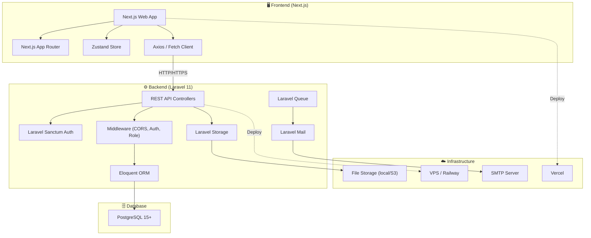
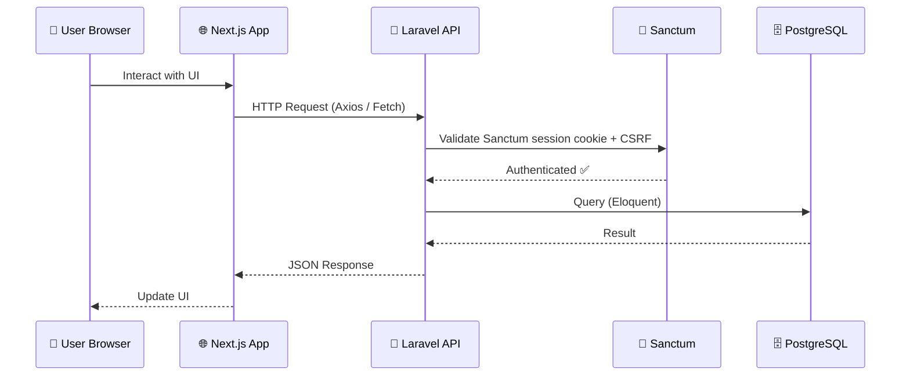
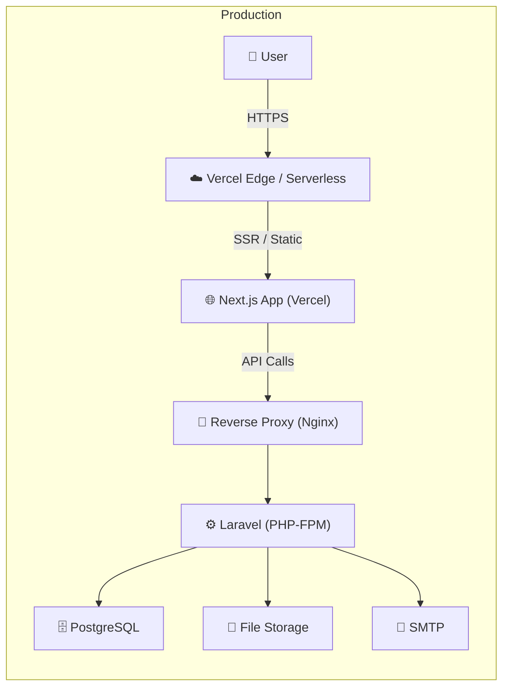
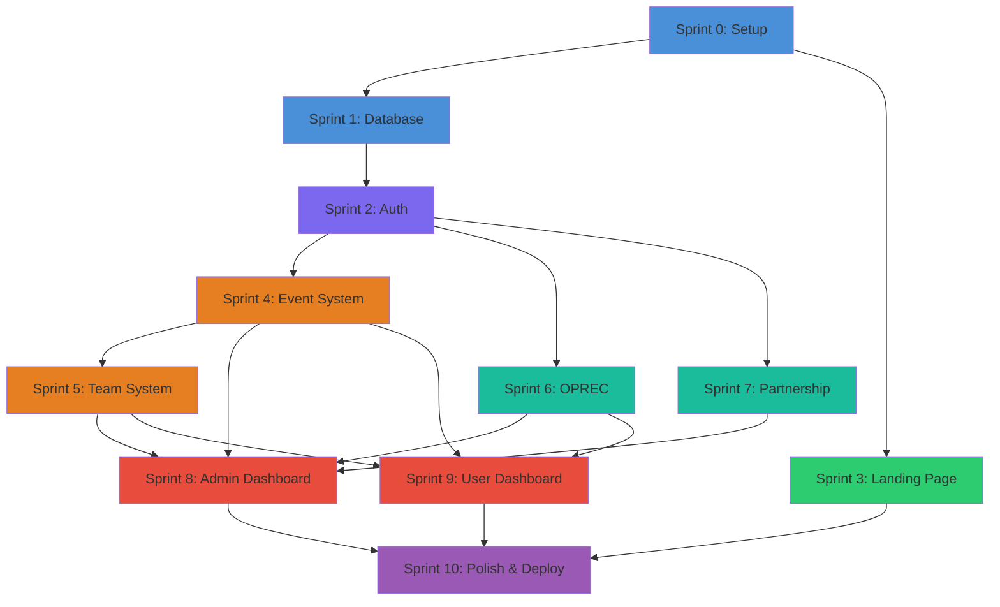

# 🏗️ Architecture & Implementation Plan — SIMANIKA

> **Dokumen Arsitektur & Rencana Implementasi**
> Versi: 1.1
> Tanggal: 13 September 2026
> Referensi: [PRD.md](./PRD.md)

---

## 1. Arsitektur Sistem

### 1.1 High-Level Architecture



### 1.2 Request Flow



---

## 2. Tech Stack Detail

### 2.1 Frontend

| Teknologi | Versi | Fungsi |
|-----------|-------|--------|
| **Next.js** | 15+ | React Framework (App Router, SSR/SSG, Server & Client Components) |
| **React** | 19+ | Core UI Library |
| **Zustand** | 5+ | Global state management |
| **Axios** | 1.6+ | HTTP client ke Laravel API |
| **Tailwind CSS** | 4+ | Utility-first CSS |
| **shadcn/ui** | latest | UI component library |
| **React Hook Form** | 7+ | Form handling |
| **Zod** | 3+ | Schema validation |
| **Framer Motion** | 11+ | Animasi & transitions |
| **Lucide React** | latest | Icon library |
| **Next.js Metadata API** | built-in | SEO meta tags & Open Graph |
| **react-hot-toast / Sonner** | latest | Toast notifications |
| **date-fns** | latest | Date formatting |

### 2.2 Backend

| Teknologi | Versi | Fungsi |
|-----------|-------|--------|
| **Laravel** | 11 | PHP Framework |
| **PHP** | 8.2+ | Server language |
| **Laravel Sanctum** | 4+ | SPA authentication berbasis session/cookie HttpOnly + CSRF |
| **Eloquent** | (Laravel) | ORM |
| **Laravel Storage** | (Laravel) | File management |
| **Laravel Mail** | (Laravel) | Email sending |
| **Laravel Queue** | (Laravel) | Background jobs |
| **Spatie Laravel Permission** | 6+ | Role management (opsional) |

### 2.3 Database & Hosting

| Teknologi | Versi | Fungsi |
|-----------|-------|--------|
| **PostgreSQL** | 15+ | Relational database |
| **Vercel** | — | Frontend hosting (Next.js native) |
| **VPS / Railway** | — | Backend hosting |
| **Google Analytics 4** | — | Analytics |

---

## 3. Folder Structure

### 3.1 Frontend (`/frontend`)

```
frontend/
├── public/
│   ├── favicon.ico
│   ├── robots.txt
│   └── sitemap.xml
├── src/
│   ├── app/                    # Next.js App Router
│   │   ├── (public)/           # Public route group
│   │   │   ├── page.jsx        # Landing page (Home)
│   │   │   ├── events/
│   │   │   │   ├── page.jsx    # Event list
│   │   │   │   └── [slug]/
│   │   │   │       └── page.jsx# Event detail
│   │   │   ├── oprec/
│   │   │   │   └── page.jsx    # Oprec info
│   │   │   ├── partnership/
│   │   │   │   └── page.jsx    # Partnership info
│   │   │   ├── login/
│   │   │   │   └── page.jsx    # Login page
│   │   │   └── register/
│   │   │       └── page.jsx    # Register page
│   │   ├── (user)/             # Authenticated user route group
│   │   │   ├── layout.jsx      # User layout
│   │   │   ├── dashboard/
│   │   │   │   └── page.jsx    # User dashboard
│   │   │   ├── my-teams/
│   │   │   │   └── page.jsx    # My teams
│   │   │   ├── events/[slug]/register/
│   │   │   │   └── page.jsx    # Event registration
│   │   │   ├── oprec/register/
│   │   │   │   └── page.jsx    # Oprec registration
│   │   │   └── profile/
│   │   │       └── page.jsx    # User profile
│   │   ├── admin/              # Admin route group
│   │   │   ├── layout.jsx      # Admin sidebar layout
│   │   │   ├── page.jsx        # Admin dashboard
│   │   │   ├── events/
│   │   │   │   ├── page.jsx    # Manage events
│   │   │   │   ├── create/
│   │   │   │   │   └── page.jsx# Create event
│   │   │   │   ├── [id]/edit/
│   │   │   │   │   └── page.jsx# Edit event
│   │   │   │   ├── [id]/registrants/
│   │   │   │   │   └── page.jsx# Event registrants
│   │   │   │   └── [id]/teams/
│   │   │   │       └── page.jsx# Event teams
│   │   │   ├── oprec/
│   │   │   │   ├── page.jsx    # Manage oprec
│   │   │   │   └── registrants/
│   │   │   │       └── page.jsx# Oprec registrants
│   │   │   ├── partnership/
│   │   │   │   └── page.jsx    # Manage partnership
│   │   │   ├── content/
│   │   │   │   └── page.jsx    # Manage site content
│   │   │   └── settings/
│   │   │       └── page.jsx    # Settings
│   │   ├── layout.jsx          # Root layout
│   │   ├── globals.css         # Global styles + Tailwind
│   │   ├── not-found.jsx       # 404 page
│   │   └── error.jsx           # Error boundary
│   ├── components/             # Reusable UI components
│   │   ├── ui/                 # shadcn/ui components
│   │   ├── layout/             # Navbar, Footer, AdminSidebar
│   │   │   ├── Navbar.jsx
│   │   │   ├── Footer.jsx
│   │   │   └── AdminSidebar.jsx
│   │   ├── common/             # Shared components
│   │   │   ├── LoadingSpinner.jsx
│   │   │   ├── EmptyState.jsx
│   │   │   └── StatusBadge.jsx
│   │   ├── forms/              # Form components
│   │   │   ├── LoginForm.jsx
│   │   │   ├── RegisterForm.jsx
│   │   │   └── DynamicFormField.jsx
│   │   └── sections/           # Landing page sections
│   │       ├── HeroSection.jsx
│   │       ├── AboutSection.jsx
│   │       ├── VisiMisiSection.jsx
│   │       ├── StrukturSection.jsx
│   │       ├── DivisiSection.jsx
│   │       ├── ProkerSection.jsx
│   │       ├── StatistikSection.jsx
│   │       ├── UpcomingEventsSection.jsx
│   │       ├── GallerySection.jsx
│   │       ├── TestimonialSection.jsx
│   │       └── CTASection.jsx
│   ├── hooks/                  # Custom React hooks
│   │   ├── useAuth.js
│   │   ├── useEvents.js
│   │   ├── useTeams.js
│   │   └── useApi.js
│   ├── services/               # API service layer
│   │   ├── api.js              # Axios instance & interceptors
│   │   ├── authService.js
│   │   ├── eventService.js
│   │   ├── teamService.js
│   │   ├── oprecService.js
│   │   ├── partnershipService.js
│   │   └── contentService.js
│   ├── store/                  # Zustand stores
│   │   ├── authStore.js
│   │   └── uiStore.js
│   ├── lib/                    # Utility functions
│   │   ├── utils.js
│   │   ├── constants.js
│   │   └── validators.js
├── .env.local                  # Environment variables
├── next.config.mjs             # Next.js config
├── tailwind.config.js          # Tailwind config
├── postcss.config.js           # PostCSS config
└── package.json
```

### 3.2 Backend (`/backend`)

```
backend/
├── app/
│   ├── Http/
│   │   ├── Controllers/
│   │   │   ├── Auth/
│   │   │   │   ├── LoginController.php
│   │   │   │   ├── RegisterController.php
│   │   │   │   └── ProfileController.php
│   │   │   ├── Public/
│   │   │   │   ├── HomeController.php
│   │   │   │   ├── PublicEventController.php
│   │   │   │   ├── PublicOprecController.php
│   │   │   │   └── PublicPartnershipController.php
│   │   │   ├── User/
│   │   │   │   ├── DashboardController.php
│   │   │   │   ├── EventRegistrationController.php
│   │   │   │   ├── TeamController.php
│   │   │   │   └── OprecRegistrationController.php
│   │   │   └── Admin/
│   │   │       ├── AdminDashboardController.php
│   │   │       ├── EventController.php
│   │   │       ├── EventRegistrantController.php
│   │   │       ├── TeamManagementController.php
│   │   │       ├── OprecController.php
│   │   │       ├── OprecRegistrantController.php
│   │   │       ├── PartnershipController.php
│   │   │       ├── ContentController.php
│   │   │       └── ExportController.php
│   │   ├── Middleware/
│   │   │   ├── AdminMiddleware.php
│   │   │   └── CorsMiddleware.php
│   │   ├── Requests/       # Form Request validation
│   │   │   ├── Auth/
│   │   │   ├── Event/
│   │   │   ├── Team/
│   │   │   ├── Oprec/
│   │   │   └── Partnership/
│   │   └── Resources/      # API Resource transformers
│   │       ├── UserResource.php
│   │       ├── EventResource.php
│   │       ├── TeamResource.php
│   │       ├── OprecResource.php
│   │       └── PartnershipResource.php
│   ├── Models/
│   │   ├── User.php
│   │   ├── Event.php
│   │   ├── EventFormField.php
│   │   ├── EventPrize.php
│   │   ├── EventRequirement.php
│   │   ├── Team.php
│   │   ├── TeamMember.php
│   │   ├── EventRegistration.php
│   │   ├── FileUpload.php
│   │   ├── Oprec.php
│   │   ├── OprecDivision.php
│   │   ├── OprecRegistration.php
│   │   ├── Partnership.php
│   │   ├── PartnershipInquiry.php
│   │   ├── SiteContent.php
│   │   ├── StrukturOrganisasi.php
│   │   ├── Divisi.php
│   │   ├── ProgramKerja.php
│   │   ├── Gallery.php
│   │   └── Testimonial.php
│   ├── Services/           # Business logic layer
│   │   ├── TeamService.php
│   │   ├── EventService.php
│   │   └── ExportService.php
│   └── Mail/
│       ├── RegistrationConfirmation.php
│       ├── StatusUpdate.php
│       └── OprecConfirmation.php
├── database/
│   ├── migrations/         # Database migrations
│   ├── seeders/            # Data seeders
│   └── factories/          # Model factories
├── routes/
│   ├── api.php             # API routes
│   └── web.php
├── storage/
│   └── app/public/         # Uploaded files
├── .env
├── composer.json
└── phpunit.xml
```

---

## 4. API Endpoints

### 4.1 Authentication (`/api/auth`)

| Method | Endpoint | Deskripsi | Auth |
|--------|----------|-----------|------|
| `POST` | `/api/auth/register` | Register user baru | ❌ |
| `POST` | `/api/auth/login` | Login user | ❌ |
| `POST` | `/api/auth/logout` | Logout user | ✅ |
| `GET` | `/api/auth/me` | Get current user profile | ✅ |
| `PUT` | `/api/auth/profile` | Update profile | ✅ |
| `POST` | `/api/auth/change-password` | Ganti password | ✅ |
| `POST` | `/api/auth/forgot-password` | Kirim tautan reset password | ❌ |
| `POST` | `/api/auth/reset-password` | Reset password memakai token email | ❌ |

### 4.2 Public (`/api/public`)

| Method | Endpoint | Deskripsi | Auth |
|--------|----------|-----------|------|
| `GET` | `/api/public/home` | Get site content (landing page) | ❌ |
| `GET` | `/api/public/events` | List published events | ❌ |
| `GET` | `/api/public/events/{slug}` | Detail event | ❌ |
| `GET` | `/api/public/oprec` | Get oprec info | ❌ |
| `GET` | `/api/public/partnerships` | List partnerships | ❌ |
| `POST` | `/api/public/partnership-inquiry` | Submit partnership form | ❌ |

### 4.3 User (`/api/user`)

| Method | Endpoint | Deskripsi | Auth |
|--------|----------|-----------|------|
| `GET` | `/api/user/dashboard` | User dashboard data | ✅ User |
| `POST` | `/api/user/events/{id}/register` | Daftar event (individu) | ✅ User |
| `GET` | `/api/user/registrations` | List registrasi user | ✅ User |
| `POST` | `/api/user/teams/create` | Bentuk tim baru | ✅ User |
| `POST` | `/api/user/teams/join` | Join tim dengan `event_id` + kode | ✅ User |
| `GET` | `/api/user/teams` | List tim user | ✅ User |
| `GET` | `/api/user/teams/{id}` | Detail tim | ✅ User |
| `POST` | `/api/user/teams/{id}/leave` | Leave tim | ✅ User |
| `POST` | `/api/user/teams/{id}/kick/{userId}` | Kick anggota (ketua only) | ✅ User |
| `POST` | `/api/user/oprec/register` | Daftar OPREC | ✅ User |
| `GET` | `/api/user/oprec/status` | Cek status OPREC | ✅ User |

### 4.4 Admin (`/api/admin`)

| Method | Endpoint | Deskripsi | Auth |
|--------|----------|-----------|------|
| `GET` | `/api/admin/dashboard` | Admin dashboard stats | ✅ Admin |
| — | **Events** | — | — |
| `GET` | `/api/admin/events` | List semua events | ✅ Admin |
| `POST` | `/api/admin/events` | Create event | ✅ Admin |
| `PUT` | `/api/admin/events/{id}` | Update event | ✅ Admin |
| `DELETE` | `/api/admin/events/{id}` | Delete event | ✅ Admin |
| `GET` | `/api/admin/events/{id}/registrants` | Data pendaftar event | ✅ Admin |
| `PUT` | `/api/admin/events/{id}/registrants/{regId}` | Accept/reject pendaftar | ✅ Admin |
| `GET` | `/api/admin/events/{id}/teams` | Data tim per event | ✅ Admin |
| `PUT` | `/api/admin/teams/{id}/status` | Accept/reject tim | ✅ Admin |
| `GET` | `/api/admin/events/{id}/export` | Export data ke CSV | ✅ Admin |
| — | **OPREC** | — | — |
| `GET` | `/api/admin/oprec` | List oprec | ✅ Admin |
| `POST` | `/api/admin/oprec` | Create oprec | ✅ Admin |
| `PUT` | `/api/admin/oprec/{id}` | Update oprec | ✅ Admin |
| `GET` | `/api/admin/oprec/{id}/registrants` | Data pendaftar oprec | ✅ Admin |
| `PUT` | `/api/admin/oprec/{id}/registrants/{regId}` | Accept/reject | ✅ Admin |
| — | **Partnership** | — | — |
| `POST` | `/api/admin/partnerships` | Add partnership | ✅ Admin |
| `PUT` | `/api/admin/partnerships/{id}` | Update partnership | ✅ Admin |
| `DELETE` | `/api/admin/partnerships/{id}` | Delete partnership | ✅ Admin |
| `GET` | `/api/admin/partnership-inquiries` | List inquiries | ✅ Admin |
| `PUT` | `/api/admin/partnership-inquiries/{id}` | Update status inquiry | ✅ Admin |
| — | **Content** | — | — |
| `GET` | `/api/admin/content` | Get site content | ✅ Admin |
| `PUT` | `/api/admin/content` | Update site content | ✅ Admin |
| — | **File Upload** | — | — |
| `POST` | `/api/upload` | Upload file | ✅ |

---

## 5. Sprint Plan (Rencana Implementasi)

Proyek dipecah menjadi **10 sprint** yang bisa dikerjakan secara berurutan. Setiap sprint punya kriteria selesai yang jelas.

---

### 🔵 Sprint 0 — Project Setup & Boilerplate
**Durasi**: 1-2 hari
**Dependencies**: Tidak ada

#### Tasks:
- [ ] **FE-0.1**: Init project Next.js (`npx create-next-app@latest frontend`)
- [ ] **FE-0.2**: Install dependencies (Tailwind, Axios, Zustand, shadcn/ui, lucide-react, dll)
- [ ] **FE-0.3**: Setup Tailwind CSS + shadcn/ui config
- [ ] **FE-0.4**: Setup folder structure sesuai section 3.1
- [ ] **FE-0.5**: Setup Next.js App Router dengan layout & route skeleton (halaman kosong)
- [ ] **FE-0.6**: Setup Axios instance + interceptors (`services/api.js`)
- [ ] **BE-0.1**: Init project Laravel 11 (`composer create-project laravel/laravel backend`)
- [ ] **BE-0.2**: Install packages (Sanctum, CORS, dll)
- [ ] **BE-0.3**: Setup `.env` (database connection, app key, CORS origins)
- [ ] **BE-0.4**: Configure CORS middleware untuk frontend origin
- [ ] **BE-0.5**: Setup Sanctum config untuk SPA auth
- [ ] **BE-0.6**: Setup folder structure sesuai section 3.2
- [ ] **DB-0.1**: Install PostgreSQL & create database `simanika`
- [ ] **DB-0.2**: Configure Laravel `.env` DB connection

#### ✅ Done Criteria:
- [ ] `npm run dev` di frontend → Next.js app berjalan di `localhost:3000`
- [ ] `php artisan serve` di backend → Laravel berjalan di `localhost:8000`
- [ ] Frontend bisa hit API backend (test endpoint `/api/ping` → `{"status": "ok"}`)
- [ ] PostgreSQL terkoneksi dari Laravel (`php artisan migrate` sukses)
- [ ] CORS berfungsi (no CORS error di browser)

---

### 🔵 Sprint 1 — Database Schema & Migrations
**Durasi**: 1-2 hari
**Dependencies**: Sprint 0

#### Tasks:
- [ ] **DB-1.1**: Buat migration `users` (extend default Laravel users table)
- [ ] **DB-1.2**: Buat migration `events`
- [ ] **DB-1.3**: Buat migration `event_form_fields`
- [ ] **DB-1.4**: Buat migration `event_prizes`
- [ ] **DB-1.5**: Buat migration `event_requirements`
- [ ] **DB-1.6**: Buat migration `teams`
- [ ] **DB-1.7**: Buat migration `team_members`
- [ ] **DB-1.8**: Buat migration `event_registrations`
- [ ] **DB-1.9**: Buat migration `file_uploads`
- [ ] **DB-1.10**: Buat migration `oprecs`
- [ ] **DB-1.11**: Buat migration `oprec_divisions`
- [ ] **DB-1.12**: Buat migration `oprec_registrations`
- [ ] **DB-1.13**: Buat migration `partnerships`
- [ ] **DB-1.14**: Buat migration `partnership_inquiries`
- [ ] **DB-1.15**: Buat migration `site_contents` + tabel terkait (struktur, divisi, proker, gallery, testimonials)
- [ ] **DB-1.16**: Buat semua Eloquent Models dengan relationships
- [ ] **DB-1.17**: Buat Seeders (admin user, sample site content)
- [ ] **DB-1.18**: Buat Factories untuk testing data

#### ✅ Done Criteria:
- [ ] `php artisan migrate` sukses tanpa error
- [ ] `php artisan migrate:rollback` sukses (semua `down()` method benar)
- [ ] `php artisan db:seed` sukses — admin user & site content terisi
- [ ] Semua 20 tabel domain terbuat di PostgreSQL dengan constraint yang benar (tabel infrastruktur Laravel dihitung terpisah)
- [ ] Semua Model memiliki `$fillable`, `$casts`, dan `relationships` yang benar
- [ ] `php artisan tinker` → test relasi Model (e.g., `Event::first()->teams`)

---

### 🔵 Sprint 2 — Authentication System
**Durasi**: 2-3 hari
**Dependencies**: Sprint 1

#### Tasks (Backend):
- [ ] **BE-2.1**: Setup Sanctum SPA authentication
- [ ] **BE-2.2**: Buat `RegisterController` — register + auto-login
- [ ] **BE-2.3**: Buat `LoginController` — login + session cookie HttpOnly
- [ ] **BE-2.4**: Buat `ProfileController` — get/update profile, change password
- [ ] **BE-2.5**: Buat `AdminMiddleware` — cek role admin
- [ ] **BE-2.6**: Buat Form Requests (RegisterRequest, LoginRequest, UpdateProfileRequest)
- [ ] **BE-2.7**: Buat `UserResource` API Resource
- [ ] **BE-2.8**: Setup route groups di `routes/api.php` (public, auth, user, admin)

#### Tasks (Frontend):
- [ ] **FE-2.1**: Buat `authStore` (Zustand) — state: user, isAuthenticated, isAdmin (tanpa menyimpan token)
- [ ] **FE-2.2**: Buat `authService` — register, login, logout, getProfile API calls
- [ ] **FE-2.3**: Setup Axios `withCredentials`, inisialisasi CSRF cookie, serta penanganan 401/419
- [ ] **FE-2.4**: Buat `Login.jsx` page — form + validasi + submit
- [ ] **FE-2.5**: Buat `Register.jsx` page — form + validasi + submit
- [ ] **FE-2.6**: Buat `ProtectedRoute` component — redirect ke login jika belum auth
- [ ] **FE-2.7**: Buat `AdminRoute` component — redirect jika bukan admin
- [ ] **FE-2.8**: Buat `useAuth` hook — login, logout, check auth status
- [ ] **FE-2.9**: Update Navbar — conditional render (Login button vs User dropdown)
- [ ] **BE-2.9**: Implementasi forgot/reset password berbasis email
- [ ] **FE-2.10**: Buat halaman forgot/reset password

#### ✅ Done Criteria:
- [ ] User bisa register → otomatis login → redirect ke dashboard
- [ ] User bisa login → session aktif → Navbar berubah
- [ ] User bisa logout → session dicabut → redirect ke home
- [ ] Protected route redirect ke login jika belum auth
- [ ] Admin route redirect ke home jika bukan admin
- [ ] Profile bisa diupdate (nama, foto, password)
- [ ] API menolak request tanpa auth dengan 401
- [ ] API menolak request non-admin ke `/api/admin/*` dengan 403

---

### 🔵 Sprint 3 — Landing Page (Home)
**Durasi**: 3-5 hari
**Dependencies**: Sprint 0 (bisa parallel dengan Sprint 1 & 2)

#### Tasks (Backend):
- [ ] **BE-3.1**: Buat `HomeController` — endpoint GET `/api/public/home`
- [ ] **BE-3.2**: Return semua site_content data (about, visi, misi, struktur, divisi, proker, statistik, gallery, testimonials, sosmed)

#### Tasks (Frontend):
- [ ] **FE-3.1**: Buat `Navbar.jsx` — sticky, responsive, mobile hamburger menu
- [ ] **FE-3.2**: Buat `Footer.jsx` — kontak, sosmed, quick links
- [ ] **FE-3.3**: Buat `HeroSection.jsx` — tagline, CTA buttons, background animasi
- [ ] **FE-3.4**: Buat `AboutSection.jsx` — deskripsi HIMANIKA
- [ ] **FE-3.5**: Buat `VisiMisiSection.jsx` — visi & daftar misi
- [ ] **FE-3.6**: Buat `StrukturSection.jsx` — grid foto + nama + jabatan pengurus
- [ ] **FE-3.7**: Buat `DivisiSection.jsx` — card grid divisi
- [ ] **FE-3.8**: Buat `ProkerSection.jsx` — program kerja cards
- [ ] **FE-3.9**: Buat `StatistikSection.jsx` — counter animasi (intersection observer)
- [ ] **FE-3.10**: Buat `UpcomingEventsSection.jsx` — preview 3-4 event card
- [ ] **FE-3.11**: Buat `GallerySection.jsx` — grid foto + lightbox
- [ ] **FE-3.12**: Buat `TestimonialSection.jsx` — slider quotes
- [ ] **FE-3.13**: Buat `CTASection.jsx` — ajakan bergabung
- [ ] **FE-3.14**: Compose semua section di `Home.jsx`
- [ ] **FE-3.15**: Implementasi scroll animations (Framer Motion InView)
- [ ] **FE-3.16**: Responsive design (mobile, tablet, desktop)
- [ ] **FE-3.17**: SEO metadata via Next.js Metadata API

#### ✅ Done Criteria:
- [ ] Home page menampilkan **semua 13 section** dengan konten dari API
- [ ] Navbar sticky, responsive, hamburger menu di mobile
- [ ] Scroll animation berjalan smooth (fade-in, slide-up)
- [ ] Counter statistik teranimate saat di-scroll ke view
- [ ] Testimonial slider berfungsi (auto-play + manual)
- [ ] Semua section responsive di 3 breakpoint (mobile/tablet/desktop)
- [ ] Lighthouse Performance score ≥ 85
- [ ] Semua CTA button mengarah ke route yang benar

---

### 🔵 Sprint 4 — Event System
**Durasi**: 3-4 hari
**Dependencies**: Sprint 1, Sprint 2

#### Tasks (Backend):
- [ ] **BE-4.1**: Buat `PublicEventController` — list events (filter, search, paginate), detail event
- [ ] **BE-4.2**: Buat `EventRegistrationController` — register event (individu)
- [ ] **BE-4.3**: Buat `EventResource` + `EventCollection` (API transformer)
- [ ] **BE-4.4**: Buat Form Requests (StoreEventRegistrationRequest)
- [ ] **BE-4.5**: Handle file upload saat registrasi
- [ ] **BE-4.6**: Buat admin `EventController` — full CRUD event
- [ ] **BE-4.7**: Admin create event: handle form fields, prizes, requirements (nested create)
- [ ] **BE-4.8**: Buat `EventRegistrantController` — list registrants, accept/reject
- [ ] **BE-4.9**: Buat `ExportController` — export registrants ke CSV

#### Tasks (Frontend):
- [ ] **FE-4.1**: Buat `EventList.jsx` — grid cards, filter bar (kategori, status), search, pagination
- [ ] **FE-4.2**: Buat `EventCard.jsx` component — poster, judul, tanggal, badge, CTA
- [ ] **FE-4.3**: Buat `EventDetail.jsx` — banner, deskripsi, timeline, syarat, hadiah, countdown
- [ ] **FE-4.4**: Buat `EventRegister.jsx` — dynamic form berdasarkan form_fields event
- [ ] **FE-4.5**: Buat `eventService.js` — semua API calls terkait event
- [ ] **FE-4.6**: Admin: `ManageEvents.jsx` — tabel event, tombol CRUD
- [ ] **FE-4.7**: Admin: `CreateEvent.jsx` — form buat event + dynamic form field builder
- [ ] **FE-4.8**: Admin: `EditEvent.jsx` — form edit event
- [ ] **FE-4.9**: Admin: `EventRegistrants.jsx` — tabel pendaftar, accept/reject, export

#### ✅ Done Criteria:
- [ ] Public: User bisa browse event, filter, search, lihat detail
- [ ] User: User bisa daftar event individu → status muncul di dashboard
- [ ] Admin: Bisa create event lengkap (termasuk form fields, prizes, requirements)
- [ ] Admin: Bisa edit & delete event
- [ ] Admin: Bisa lihat data pendaftar, accept/reject, export CSV
- [ ] File upload berfungsi (poster event + berkas pendaftaran)
- [ ] Countdown timer berjalan di event detail
- [ ] Pagination berfungsi di event list

---

### 🔵 Sprint 5 — Team System (Event Lomba)
**Durasi**: 3-4 hari
**Dependencies**: Sprint 4

#### Tasks (Backend):
- [ ] **BE-5.1**: Buat `TeamService` — business logic: create team, join team, leave, kick
- [ ] **BE-5.2**: Buat `TeamController` (User) — create team + generate kode
- [ ] **BE-5.3**: Implement kode generation logic dengan lebar nomor minimum 2 digit:
  ```php
  // Di TeamService.php
  DB::transaction(function () {
      $event = Event::lockForUpdate()->find($eventId);
      $event->increment('last_team_number');
      $kode = $event->kode_prefix . str_pad($event->last_team_number, 2, '0', STR_PAD_LEFT);
      // Create team with kode...
  });
  ```
- [ ] **BE-5.4**: Endpoint join team dengan `event_id` + kode — validasi: pasangan kode ada, slot tersedia, user belum di tim lain
- [ ] **BE-5.5**: Endpoint leave team — update jumlah_anggota, handle ketua leave
- [ ] **BE-5.6**: Endpoint kick member — only ketua, update jumlah_anggota
- [ ] **BE-5.7**: Auto-update `completion_status` saat member join/leave; `review_status` dikelola admin secara terpisah
- [ ] **BE-5.8**: Admin `TeamManagementController` — list teams, detail, accept/reject

#### Tasks (Frontend):
- [ ] **FE-5.1**: Update `EventDetail.jsx` — tampilkan "Bentuk Tim" button untuk event bertipe tim
- [ ] **FE-5.2**: Buat modal/page **"Bentuk Tim"** — pilih event, isi nama tim, tampilkan kode
- [ ] **FE-5.3**: Buat modal **"Join Tim"** — pilih event, input kode, validasi, feedback
- [ ] **FE-5.4**: Buat `MyTeams.jsx` (User Dashboard) — list tim, kode, status, anggota
- [ ] **FE-5.5**: Buat **"Kelola Tim"** page (ketua) — list anggota, copy kode, kick button
- [ ] **FE-5.6**: Copy-to-clipboard untuk kode tim
- [ ] **FE-5.7**: Buat `teamService.js` — API calls
- [ ] **FE-5.8**: Admin: `EventTeams.jsx` — tabel data tim per event, detail anggota, accept/reject

#### ✅ Done Criteria:
- [ ] Ketua bisa bentuk tim → kode ter-generate (format: `PREFIX` + nomor minimum 2 digit; `HACK100` valid)
- [ ] Kode case-insensitive saat join (`HACK01` = `hack01`) dan selalu dipasangkan dengan `event_id`
- [ ] Anggota bisa join via kode → muncul di list tim
- [ ] Validasi: user tidak bisa join 2 tim di event yang sama
- [ ] Validasi: tidak bisa join tim yang sudah penuh
- [ ] Ketua bisa kick anggota → jumlah_anggota berkurang
- [ ] Anggota bisa leave → jumlah_anggota berkurang
- [ ] `completion_status` otomatis update: `incomplete` ↔ `complete`; tidak menimpa `review_status`
- [ ] Roster tidak dapat diubah setelah tim diterima atau deadline terlewati
- [ ] Admin bisa lihat semua tim per event + accept/reject
- [ ] Kode tim bisa di-copy ke clipboard

---

### 🔵 Sprint 6 — OPREC System
**Durasi**: 2-3 hari
**Dependencies**: Sprint 2

#### Tasks (Backend):
- [ ] **BE-6.1**: Buat `PublicOprecController` — get active oprec, list divisions
- [ ] **BE-6.2**: Buat `OprecRegistrationController` (User) — submit form + file upload
- [ ] **BE-6.3**: Buat admin `OprecController` — CRUD oprec, manage divisions
- [ ] **BE-6.4**: Buat admin `OprecRegistrantController` — list, filter per divisi, accept/reject, export
- [ ] **BE-6.5**: Buat Form Requests (StoreOprecRegistrationRequest)

#### Tasks (Frontend):
- [ ] **FE-6.1**: Buat `Oprec.jsx` — status OPREC, info, divisi cards, FAQ, CTA
- [ ] **FE-6.2**: Buat `OprecRegister.jsx` — form: data diri, pilihan divisi, motivasi, upload
- [ ] **FE-6.3**: Buat `oprecService.js` — API calls
- [ ] **FE-6.4**: Update Dashboard — section "OPREC Saya" (status pendaftaran)
- [ ] **FE-6.5**: Admin: `ManageOprec.jsx` — CRUD oprec + manage divisi
- [ ] **FE-6.6**: Admin: `OprecRegistrants.jsx` — tabel, filter per divisi, accept/reject, export

#### ✅ Done Criteria:
- [ ] Public: Halaman OPREC menampilkan status (buka/tutup), info, divisi
- [ ] User: Bisa daftar OPREC (pilih divisi, isi motivasi, upload CV/foto)
- [ ] User: Status pendaftaran muncul di dashboard
- [ ] Admin: Bisa buat/edit/tutup OPREC
- [ ] Admin: Bisa lihat pendaftar per divisi, accept/reject, export
- [ ] Validasi: User tidak bisa daftar 2x di OPREC yang sama

---

### 🔵 Sprint 7 — Partnership System
**Durasi**: 1-2 hari
**Dependencies**: Sprint 2

#### Tasks (Backend):
- [ ] **BE-7.1**: Buat `PublicPartnershipController` — list active partnerships
- [ ] **BE-7.2**: Buat endpoint submit partnership inquiry (form kolaborasi)
- [ ] **BE-7.3**: Buat admin `PartnershipController` — CRUD partnerships
- [ ] **BE-7.4**: Buat admin endpoint — list & manage inquiries

#### Tasks (Frontend):
- [ ] **FE-7.1**: Buat `Partnership.jsx` — header, statistik, benefit, paket, sponsor grid, form
- [ ] **FE-7.2**: Buat form kolaborasi — submit to API
- [ ] **FE-7.3**: Buat `partnershipService.js`
- [ ] **FE-7.4**: Admin: `ManagePartnership.jsx` — CRUD partnership, upload logo
- [ ] **FE-7.5**: Admin: List & manage partnership inquiries

#### ✅ Done Criteria:
- [ ] Public: Partnership page menampilkan sponsor + benefit + paket
- [ ] Public: Form kolaborasi bisa disubmit
- [ ] Admin: CRUD partnership (termasuk upload logo)
- [ ] Admin: Bisa lihat & kelola partnership inquiries (read/responded)

---

### 🔵 Sprint 8 — Admin Dashboard & CMS
**Durasi**: 2-3 hari
**Dependencies**: Sprint 4, 5, 6, 7

#### Tasks (Backend):
- [ ] **BE-8.1**: Buat `AdminDashboardController` — aggregate stats (total user, event, registrant, team)
- [ ] **BE-8.2**: Buat `ContentController` — get/update site content (CMS)
- [ ] **BE-8.3**: Dashboard endpoint: grafik tren pendaftar per bulan

#### Tasks (Frontend):
- [ ] **FE-8.1**: Buat `AdminDashboard.jsx` — stat cards, grafik tren (recharts/chart.js)
- [ ] **FE-8.2**: Buat `AdminSidebar.jsx` — navigasi admin panel
- [ ] **FE-8.3**: Buat admin layout wrapper (sidebar + main content)
- [ ] **FE-8.4**: Buat `ManageContent.jsx` — CMS form untuk edit konten Home
- [ ] **FE-8.5**: CRUD struktur organisasi (add/edit/delete/reorder pengurus)
- [ ] **FE-8.6**: CRUD divisi, program kerja, gallery, testimonials
- [ ] **FE-8.7**: Polish semua admin pages (loading states, error handling, confirmation dialogs)

#### ✅ Done Criteria:
- [ ] Dashboard menampilkan statistik akurat (total user, event, registrant, tim)
- [ ] Grafik tren pendaftar per bulan ter-render
- [ ] CMS: Admin bisa edit semua konten Home (about, visi, misi, struktur, dll)
- [ ] CMS: Perubahan langsung terrefleksi di landing page
- [ ] Admin sidebar navigasi berfungsi sempurna
- [ ] Semua admin page ada loading state & error handling

---

### 🔵 Sprint 9 — User Dashboard
**Durasi**: 2-3 hari
**Dependencies**: Sprint 4, 5, 6

#### Tasks (Backend):
- [ ] **BE-9.1**: Buat `DashboardController` — aggregate user data (events, teams, oprec)
- [ ] **BE-9.2**: Endpoint: user notifications (opsional)

#### Tasks (Frontend):
- [ ] **FE-9.1**: Buat `Dashboard.jsx` — overview cards (event diikuti, tim aktif, status oprec)
- [ ] **FE-9.2**: Section "Event Saya" — list registrasi + status badge
- [ ] **FE-9.3**: Section "Tim Saya" — list tim + kode + status + tombol Bentuk/Join
- [ ] **FE-9.4**: Section "OPREC Saya" — status pendaftaran
- [ ] **FE-9.5**: Buat `Profile.jsx` — edit profil + foto + password
- [ ] **FE-9.6**: Responsive design untuk dashboard

#### ✅ Done Criteria:
- [ ] Dashboard menampilkan ringkasan user (events, teams, oprec)
- [ ] User bisa melihat status semua pendaftaran
- [ ] Section Tim Saya berfungsi (Bentuk Tim, Join Tim, Kelola Tim)
- [ ] Profil bisa di-update + foto profil terupload
- [ ] Dashboard responsive di mobile

---

### 🔵 Sprint 10 — Polish, Testing & Deployment
**Durasi**: 3-5 hari
**Dependencies**: Semua sprint sebelumnya

#### Tasks (Testing):
- [ ] **QA-10.1**: End-to-end testing semua user flows
- [ ] **QA-10.2**: Test responsive di berbagai device/browser
- [ ] **QA-10.3**: Test edge cases (form validation, error states, empty states)
- [ ] **QA-10.4**: Test concurrent team join (race condition)
- [ ] **QA-10.5**: Security testing (SQL injection, XSS, CSRF)

#### Tasks (Polish):
- [ ] **PL-10.1**: Loading skeleton untuk semua page
- [ ] **PL-10.2**: Error boundary & 404 page
- [ ] **PL-10.3**: Empty state illustrations
- [ ] **PL-10.4**: Toast notifications untuk semua aksi
- [ ] **PL-10.5**: Konfirmasi dialog untuk aksi destructive (delete, reject)
- [ ] **PL-10.6**: Optimisasi gambar (lazy load, WebP, responsive images)
- [ ] **PL-10.7**: Accessibility audit (contrast, keyboard nav, ARIA)

#### Tasks (SEO):
- [ ] **SEO-10.1**: Meta tags di semua page (title, description, OG)
- [ ] **SEO-10.2**: Sitemap.xml & robots.txt
- [ ] **SEO-10.3**: Structured data / JSON-LD (opsional)

#### Tasks (Deployment):
- [ ] **DEP-10.1**: Setup environment variables production
- [ ] **DEP-10.2**: Build frontend (`npm run build`)
- [ ] **DEP-10.3**: Deploy frontend ke Vercel/Netlify
- [ ] **DEP-10.4**: Setup VPS/Railway untuk Laravel backend
- [ ] **DEP-10.5**: Setup PostgreSQL production database
- [ ] **DEP-10.6**: Configure Laravel production (cache, queue, storage link)
- [ ] **DEP-10.7**: Setup domain & SSL
- [ ] **DEP-10.8**: Setup CI/CD pipeline (opsional)

#### ✅ Done Criteria:
- [ ] Semua user flows berjalan tanpa error
- [ ] Responsive di Chrome, Firefox, Safari (mobile & desktop)
- [ ] Lighthouse scores: Performance ≥ 85, Accessibility ≥ 90, SEO ≥ 90
- [ ] Backend production berjalan stabil
- [ ] Frontend ter-deploy dan accessible via domain
- [ ] Database production terisi dengan initial data (admin user, site content)
- [ ] File upload berfungsi di production
- [ ] HTTPS aktif di semua environment

---

## 6. Environment Variables

### 6.1 Frontend (`.env.local`)
```env
NEXT_PUBLIC_API_BASE_URL=http://localhost:8000/api
NEXT_PUBLIC_APP_NAME=SIMANIKA
NEXT_PUBLIC_GA_TRACKING_ID=G-XXXXXXXXXX
```

### 6.2 Backend (`.env`)
```env
APP_NAME=SIMANIKA
APP_ENV=local
APP_KEY=base64:...
APP_URL=http://localhost:8000

DB_CONNECTION=pgsql
DB_HOST=127.0.0.1
DB_PORT=5432
DB_DATABASE=simanika
DB_USERNAME=postgres
DB_PASSWORD=secret

SANCTUM_STATEFUL_DOMAINS=localhost:3000
SESSION_DOMAIN=localhost
SESSION_SECURE_COOKIE=false
SESSION_SAME_SITE=lax

FILESYSTEM_DISK=public
MAIL_MAILER=smtp
MAIL_HOST=smtp.gmail.com
MAIL_PORT=587
MAIL_USERNAME=
MAIL_PASSWORD=
MAIL_FROM_ADDRESS=noreply@simanika.com
MAIL_FROM_NAME="SIMANIKA"
```

---

## 7. Deployment Architecture



---

## 8. Dependency Graph (Sprint Order)



> [!TIP]
> **Sprint yang bisa dikerjakan paralel:**
> - Sprint 3 (Landing Page) bisa dikerjakan **bersamaan** dengan Sprint 1 & 2 (pakai data dummy dulu)
> - Sprint 6 (OPREC) & Sprint 7 (Partnership) bisa dikerjakan **bersamaan** setelah Sprint 2

---

## 9. Estimasi Total Waktu

| Sprint | Durasi | Kumulatif |
|--------|--------|-----------|
| Sprint 0: Setup | 1-2 hari | 1-2 hari |
| Sprint 1: Database | 1-2 hari | 2-4 hari |
| Sprint 2: Auth | 2-3 hari | 4-7 hari |
| Sprint 3: Landing Page | 3-5 hari | 5-9 hari* |
| Sprint 4: Event | 3-4 hari | 7-11 hari |
| Sprint 5: Team | 3-4 hari | 10-15 hari |
| Sprint 6: OPREC | 2-3 hari | 12-18 hari* |
| Sprint 7: Partnership | 1-2 hari | 13-20 hari* |
| Sprint 8: Admin Dashboard | 2-3 hari | 15-23 hari |
| Sprint 9: User Dashboard | 2-3 hari | 17-26 hari |
| Sprint 10: Polish & Deploy | 3-5 hari | **20-31 hari** |

*\* Bisa lebih cepat jika sprint dikerjakan paralel*

> **Total estimasi: 4-6 minggu** (kerja full-time, 1 developer)

---

> [!NOTE]
> Dokumen ini adalah **living document**. Update seiring progress development. Setiap sprint yang selesai, tandai task sebagai `[x]` dan catat blockers/issues jika ada.
